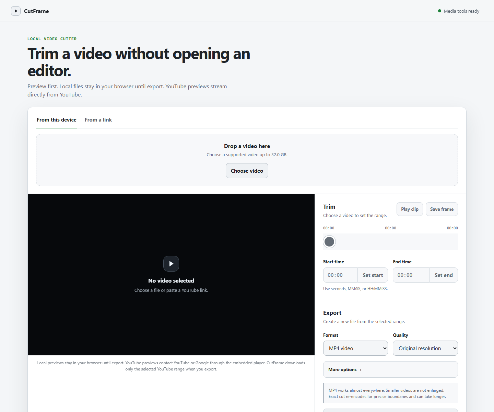

# CutFrame

CutFrame is a fast, private, local video cutter. It previews files directly in your
browser, shows YouTube videos immediately through the official privacy-enhanced
player, and creates downloadable clips through a small Flask application bound to
your own computer.

CutFrame is local-first: it has no accounts, cloud storage, analytics, or database.

## Highlights

- Preview local files without uploading them to a third-party service.
- Preview YouTube links immediately; previewing does not invoke yt-dlp or download
  the source media.
- Export only the selected YouTube time range with yt-dlp's section-download
  contract.
- Upload large local files to the loopback server in retryable 8 MiB chunks.
- Run exports in bounded background workers with progress, cancellation, cleanup,
  and direct browser downloads.
- Export MP4, MOV, WebM, GIF, MP3, and M4A files.
- Choose fast stream copy for speed or re-encoding for accurate boundaries and
  transformations.
- Limit video height without enlarging a smaller source.
- Capture the current frame from a compatible local preview as JPEG.

## Interface



The screenshot uses an empty source state and contains no local filenames, paths,
accounts, browser chrome, or private media.

## Requirements

| Tool | Supported release | Purpose |
| --- | --- | --- |
| Python | 3.10 through 3.14 | Runs the local application. CI covers 3.10, 3.12, and 3.14. |
| FFmpeg | 6 through 8; use a maintained build | Required for every export. `imageio-ffmpeg` provides a fallback executable. |
| FFprobe | Prefer the version matching FFmpeg | Provides richer duration and resolution checks. CutFrame can fall back to FFmpeg's input summary. |
| yt-dlp | 2026.07.04 or newer | Required only for YouTube export. YouTube changes frequently, so update it when extraction breaks. |
| yt-dlp-ejs | The version required by yt-dlp; 0.8.0 in the current constraints | Supplies current YouTube challenge scripts through `yt-dlp[default]`. |
| Deno | 2.3 or newer | Preferred JavaScript runtime for YouTube extraction. |
| Node.js | 22 or newer | Supported alternative to Deno. |

The application does not enforce a particular system FFmpeg patch release because
distributions package FFmpeg differently. Encoder availability also varies by
build. The release-candidate media tests exercise the FFmpeg 7.1 executable supplied
by `imageio-ffmpeg==0.6.0`; run the same tests when validating a different build.

## Quick start

Run these commands from a fresh clone of the repository. CutFrame binds only to
`127.0.0.1:5000` by default.

### Windows PowerShell

```powershell
py -3.12 -m venv .venv
Set-ExecutionPolicy -Scope Process Bypass
.\.venv\Scripts\Activate.ps1
python -m pip install --upgrade "pip>=26.1.2"
python -m pip install --requirement requirements.txt
.\run.ps1
```

If the `py` launcher is unavailable, use `python` in the first command.

### macOS and Linux

```bash
python3 -m venv .venv
. .venv/bin/activate
python -m pip install --upgrade 'pip>=26.1.2'
python -m pip install --requirement requirements.txt
./run.sh
```

If the executable bit was not preserved by an archive, use `sh run.sh`.

Open <http://127.0.0.1:5000>. Stop CutFrame with `Ctrl+C` in the terminal where it
is running.

The included server is for a local desktop workflow. It is not a production server
and must not be exposed to a LAN or the public internet.

## Installing media tools

The Python requirements install `imageio-ffmpeg`, whose platform wheel normally
contains an FFmpeg fallback. Installing a full system FFmpeg build is still useful
because it normally includes FFprobe and may support more encoders.

- Windows: `winget install --id Gyan.FFmpeg`, or install FFmpeg by another trusted
  package manager.
- macOS with Homebrew: `brew install ffmpeg`.
- Ubuntu or Debian: `sudo apt install ffmpeg`.
- Fedora: `sudo dnf install ffmpeg` after enabling an appropriate multimedia
  repository for your distribution.

For YouTube exports, install either a current Deno 2.x release or Node.js 22+ from
its official distribution channel. Some long-term-support Linux distributions ship
an older Node.js, so check with `node --version` rather than assuming the package is
new enough.

Verify the tools:

```bash
ffmpeg -version
ffprobe -version
yt-dlp --version
deno --version
node --version
```

Only one supported JavaScript runtime is required. Deno is checked before Node.js.

## Inputs and outputs

CutFrame accepts local files with these extensions:

`MP4`, `MOV`, `MKV`, `WebM`, `AVI`, `M4V`, `MPEG`, `MPG`, and `TS`.

Whether a local file previews in the browser depends on the codecs the browser can
decode. FFmpeg may still be able to export a file that cannot be previewed.

| Output | Default behavior |
| --- | --- |
| MP4 | H.264/AAC exact export with fast-start metadata; optional stream copy |
| MOV | H.264/AAC exact export; optional stream copy |
| WebM | VP9/Opus re-encode |
| GIF | 12 fps animation without audio; defaults to at most 720p when original quality is selected |
| MP3 | 192 kb/s MP3 audio |
| M4A | 192 kb/s AAC audio |

The requested video-height limits are `1080p`, `720p`, `480p`, and `360p`, plus
original resolution. The scaling filter never enlarges a smaller source. Output
support ultimately depends on the encoders compiled into the selected FFmpeg
binary.

Selections may begin at zero, include fractional seconds, and be at most 12 hours
long. The backend verifies a local selection against probed source duration before
encoding. Remote duration and availability remain subject to YouTube's responses.

## Fast copy and exact cuts

**Fast copy** is available for MP4 and MOV. It avoids re-encoding compatible
streams, so it is usually much faster and preserves source quality. Its start may
move to a nearby keyframe, and some source/container combinations cannot be copied.
When a copy is incompatible, CutFrame retries once with re-encoding.

**Exact export** re-encodes the selected range. It is slower and uses more CPU, but
it provides more accurate boundaries and enables format, resolution, mute, and
metadata changes.

No cutter can promise frame accuracy for every malformed or unusual source. Inspect
important results before discarding the original media.

## YouTube preview and export

CutFrame accepts common YouTube watch, share, mobile, music, Shorts, live, and embed
URL shapes. A URL containing playlist parameters still resolves only its single
video ID; CutFrame does not download playlists.

### Preview

Submitting a link extracts only the 11-character video ID and creates a
`youtube-nocookie.com` iframe. Preview does not run yt-dlp and does not stage a media
file. The official iframe Player API provides duration, seeking, and playback state
when the video's embedding policy permits it.

### Export

Export starts yt-dlp with `--no-playlist` and `--download-sections` for the selected
start and end. FFmpeg then packages or encodes that staged section. This avoids an
intentional full-source download. Streaming protocols, fragment boundaries, and
keyframes can still cause a small amount of adjacent media data to be transferred.

Network and fragment retries are bounded. A refreshed signed media URL is obtained
when the supported retry path is used, but an interrupted job is not guaranteed to
resume after the CutFrame server itself restarts.

YouTube support is best effort. YouTube can change its player, rate-limit requests,
disable embedding, require an account, restrict a region or age group, remove a
video, or expose only formats that the current toolchain cannot process. CutFrame
does not bypass DRM or access controls and does not promise that every video works.

## Local files, privacy, and cookies

For a local preview, the browser reads the selected file directly through an object
URL. When an export starts, the browser sends the file in chunks only to the
CutFrame server on loopback. CutFrame does not intentionally transmit local media
to a third-party service.

YouTube is different:

- Loading a preview contacts YouTube/Google through the privacy-enhanced iframe and
  Player API. Privacy-enhanced mode is not anonymity and does not prevent normal
  network metadata from reaching those services.
- Exporting contacts YouTube through yt-dlp and FFmpeg.
- Browser cookies are disabled by default. If the user explicitly selects a browser
  session, yt-dlp reads that browser's cookie store locally for that export. CutFrame
  does not automatically select, copy, upload, or save browser cookies.
- Authenticated extraction can expose account activity to YouTube and can carry
  account risk. Use it only when you understand and accept that risk.

Staged inputs and generated outputs live below `instance/jobs`. Incomplete uploads
normally expire after one hour; export-job files normally expire after 24 hours.
Cleanup occurs at startup and while the application handles requests. A clean
shutdown terminates active FFmpeg and yt-dlp child processes; an operating-system
crash may leave staged files for the next cleanup.

Do not paste diagnostics publicly without reviewing them. Filenames, tool paths, and
third-party errors can contain information about the local computer or a signed
media request.

## Configuration

CutFrame reads configuration from the process environment; it does not load a
`.env` file automatically.

| Variable | Default | Meaning |
| --- | ---: | --- |
| `CUTFRAME_MAX_LOCAL_FILE_BYTES` | `34359738368` (32 GiB) | Maximum declared local source size |
| `CUTFRAME_UPLOAD_CHUNK_BYTES` | `8388608` (8 MiB) | Requested browser upload chunk size; accepted range 64 KiB-64 MiB |
| `CUTFRAME_MAX_REQUEST_BYTES` | `16777216` (16 MiB) | Baseline per-request safety ceiling, accepted from 1-128 MiB; the effective ceiling cannot be smaller than the chunk size |
| `CUTFRAME_EXPORT_WORKERS` | `2` | Concurrent background export workers; accepted range `1`-`8` |
| `CUTFRAME_MAX_ACTIVE_UPLOADS` | `4` | Maximum registered uploads; accepted range `1`-`64` |
| `CUTFRAME_MAX_PENDING_EXPORTS` | `4` | Maximum queued plus running exports; accepted range `1`-`64` |
| `CUTFRAME_UPLOAD_TTL_SECONDS` | `3600` | Idle incomplete-upload retention; minimum `60` |
| `CUTFRAME_JOB_TTL_SECONDS` | `86400` | Completed or failed job-file retention; minimum `60` |
| `CUTFRAME_CLEANUP_INTERVAL_SECONDS` | `60` | Minimum seconds between request-triggered cleanup passes; `0` checks each request |
| `CUTFRAME_EXPORT_TIMEOUT_SECONDS` | `46800` (13 hours) | Per-tool export timeout; minimum `60` |
| `CUTFRAME_MAX_OUTPUT_BYTES` | `8589934592` (8 GiB) | Maximum selected YouTube staging file and final export; accepted up to 1 TiB |
| `CUTFRAME_MIN_FREE_DISK_BYTES` | `536870912` (512 MiB) | Free-space reserve CutFrame attempts to preserve while staging and exporting |
| `FFMPEG_BINARY` | Auto-detected | Explicit FFmpeg executable path |
| `FFPROBE_BINARY` | Auto-detected | Explicit FFprobe executable path |
| `YTDLP_BINARY` | Auto-detected | Explicit yt-dlp executable path |
| `DENO_BINARY` | Auto-detected | Explicit Deno executable path |
| `NODE_BINARY` | Auto-detected | Explicit Node.js executable path |
| `FLASK_DEBUG` | Off | Local debugging only; never use with untrusted access |

Example for PowerShell:

```powershell
$env:FFMPEG_BINARY = "C:\Tools\ffmpeg\bin\ffmpeg.exe"
$env:FFPROBE_BINARY = "C:\Tools\ffmpeg\bin\ffprobe.exe"
$env:DENO_BINARY = "C:\Tools\deno.exe"
.\run.ps1
```

Example for macOS or Linux:

```bash
export FFMPEG_BINARY=/usr/local/bin/ffmpeg
export FFPROBE_BINARY=/usr/local/bin/ffprobe
export DENO_BINARY="$HOME/.deno/bin/deno"
./run.sh
```

## Troubleshooting

### An export reaches the output or disk-space limit

Choose a shorter range or a lower resolution, then retry. The operative output cap
is the smaller of `CUTFRAME_MAX_OUTPUT_BYTES` and the free space above
`CUTFRAME_MIN_FREE_DISK_BYTES`, so it can be below 8 GiB on a nearly full disk.
Multiple simultaneous workers can observe the same free-space snapshot; the limits
bound individual files but are not a transactional disk reservation.

### FFmpeg or FFprobe is missing

Install the runtime requirements first. If the fallback is unavailable or lacks a
needed encoder, install a current system FFmpeg and optionally set `FFMPEG_BINARY`
and `FFPROBE_BINARY`. Run `ffmpeg -encoders` to inspect the build.

### YouTube JavaScript support is missing

Update the reviewed yt-dlp and EJS versions in `constraints.txt` together, then
reinstall and restart CutFrame:

```bash
python -m pip install --upgrade --requirement requirements.txt
```

Also confirm that `deno --version` is at least 2.3 or `node --version` is at least
22.

### A video is private, removed, age-restricted, region-restricted, or unavailable

Confirm that it plays and permits embedding in an ordinary browser. CutFrame cannot
override the publisher's, account's, service's, or region's access policy. Use a
browser session only when the interface offers that explicit choice and you are
authorized to access the media.

### YouTube returns a rate limit or verification request

Stop retrying repeatedly. Confirm the video in a browser, wait for the rate limit to
clear, and update yt-dlp. A selected browser session can help only when YouTube
legitimately requires the same signed-in user; it is not a general rate-limit bypass.

### A local preview is blank

The browser probably cannot decode that file's codec. CutFrame's current interface
needs browser-readable duration metadata before it can set a safe trim range, so
convert or rewrap the source to a browser-friendly MP4 or WebM with FFmpeg first.

### An upload retry reports an offset mismatch

The browser normally adopts the server's expected offset and retries. If the server
was restarted, its in-memory upload registry is gone; reload the page and start that
upload again.

## Architecture

CutFrame deliberately avoids a framework-heavy or cloud architecture:

1. `templates/index.html`, `static/app.js`, and `static/styles.css` provide the
   browser interface and local/iframe previews.
2. `app.py` validates requests and owns in-memory upload and export registries.
3. Chunked uploads and generated files are isolated below `instance/jobs`.
4. A bounded `ThreadPoolExecutor` runs background exports.
5. yt-dlp fetches remote sections; FFmpeg/FFprobe inspect and transform media.
6. Flask's conditional `send_file` response provides HTTP Range and direct download
   behavior without buffering the complete result in page JavaScript memory.

Server restarts intentionally discard the in-memory job registry. There are no user
accounts, persistent job database, telemetry services, or cloud workers.

## Development and testing

Create an isolated environment, then install runtime and development dependencies:

```bash
python -m pip install --upgrade 'pip>=26.1.2'
python -m pip install --requirement requirements-dev.txt
```

Run the local checks used by CI:

```bash
python -m compileall -q app.py tests
python -m ruff check app.py tests
node --check static/app.js
node --check scripts/browser_smoke.mjs
python -m pytest -q
node scripts/browser_smoke.mjs
python -m pip_audit --requirement requirements-dev.txt
python -m pip check
```

The automated suite uses generated or mocked media and must not depend on a live
YouTube video, signed-in browser profile, or external account. Manual YouTube checks
are optional release checks and must use public media unless the tester explicitly
authorizes a browser session. The browser smoke test requires Node.js 22+ and Chrome,
Edge, or Chromium; it does not use npm packages.

See [CONTRIBUTING.md](CONTRIBUTING.md) for the contribution workflow and manual
browser/responsive checklist.

## Known limitations

- YouTube availability changes independently of CutFrame.
- An embedding-disabled video may export while its iframe preview remains blocked.
- The current local workflow requires browser-readable duration metadata, even when
  the installed FFmpeg could decode the source by itself.
- Fast copy is keyframe-bound and may fall back to re-encoding.
- Jobs and upload sessions do not survive a server restart.
- Same-tab refresh recovery uses session storage and the in-memory server registry;
  a new tab, cleared browser storage, or a server restart cannot recover that link.
- Available codecs, hardware acceleration, and performance depend on the local
  FFmpeg build and computer.
- Output files are capped at 8 GiB by default and can be capped lower when free disk
  space approaches the 512 MiB reserve.
- The 32 GiB input limit and two-worker default protect an ordinary local machine;
  increasing them can exhaust disk, memory, or CPU resources.
- CutFrame is not designed for public network hosting or multi-user isolation.

## Responsible use

Only download, cut, and export media that you own or have permission to use. Follow
applicable law, copyright rules, service terms, and publisher restrictions. CutFrame
does not include DRM circumvention or access-control bypasses.

## License and third-party software

CutFrame's own source is available under the [MIT License](LICENSE). Dependencies
and external media tools retain their own licenses. This repository follows a
source-only release policy: it must not publish a virtual environment, FFmpeg,
FFprobe, yt-dlp executables, browser data, or other bundled third-party binaries.

See [THIRD_PARTY_NOTICES.md](THIRD_PARTY_NOTICES.md) before creating any packaged
application or binary distribution. In particular, the FFmpeg executable carried by
an `imageio-ffmpeg` wheel can be GPL-enabled even though the Python wrapper itself is
BSD-licensed.

## Creator

Created and maintained by
[V0ightt](https://www.linkedin.com/in/momen-saeb-b88183283/).

See [AUTHORS.md](AUTHORS.md) for project authorship information.
